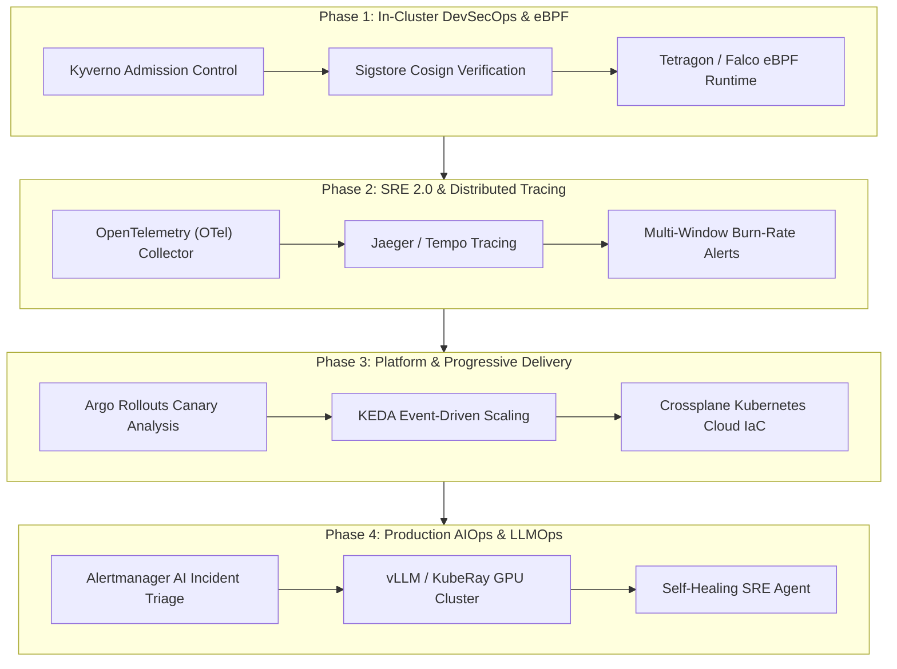

# Engineering Mastery Roadmap: DevOps, DevSecOps, SRE & AIOps

**Engineer**: Rahul Motvani  
**Target Roles**: DevOps Engineer, DevSecOps Specialist, Site Reliability Engineer (SRE), Platform Engineer, AIOps / Infrastructure Engineer  
**Profile Baseline**: 4+ Years across Linux Administration, Enterprise Networking, TryHackMe Top 3% Cybersecurity, Multi-Cloud (AWS/Azure), Terraform, and Kubernetes.

---

## Roadmap Architecture Overview



---

## Phase 1: In-Cluster DevSecOps & eBPF Runtime Security

### 1. Focus & Learning Objectives
Transition from static CI/CD scanning (Semgrep, Trivy) to **in-cluster cryptographic admission control** and **kernel-level runtime detection**.

### 2. Hands-on Assignments
- **Assignment 1.1**: Build a local multi-node Kind/K3s cluster and deploy **Kyverno**. Write a `ClusterPolicy` that blocks any pod running as `root` (`runAsNonRoot: true`), enforces a read-only root filesystem, and drops all Linux capabilities (`capDrop: ["ALL"]`).
- **Assignment 1.2**: Generate an OIDC-signed container image using Sigstore Cosign in GitHub Actions. Configure a Kyverno `verifyImages` rule that rejects container deployment unless signed by your specific GitHub repository identity.
- **Assignment 1.3**: Install **Tetragon (eBPF)** and author a tracing policy that alerts whenever a process inside a container attempts to execute a shell binary (`/bin/sh`, `/bin/bash`) or access `/etc/shadow`.

### 3. Capstone Project: Zero-Trust Cryptographic Admission & Runtime Shield
* **Directory**: `projects/kubernetes-zero-trust-admission-shield`
* **Architecture**:
  ```
  Developer Git Push ──> GitHub Actions (Cosign Sign + Syft SBOM)
                              │
  Kubernetes API <── Ingress ─┼──> Kyverno Admission Webhook (Verify Signature)
                              │         │  (Valid)
                              ▼         ▼
                      Running Pods in STRICT mTLS Mesh
                              │
                      eBPF Kernel Monitor (Tetragon / Falco)
                              │  (Syscall Anomaly Detected)
                              ▼
                      Automated SIGKILL & Wazuh Alert
  ```
* **Acceptance Criteria**:
  1. Unsigned container images are rejected by `kubectl` with HTTP 403 Forbidden.
  2. Spawning a shell (`kubectl exec -it <pod> -- /bin/sh`) triggers an immediate eBPF security event.
  3. All inter-pod communication is encrypted under Istio STRICT mTLS with zero plaintext bypass.

---

## Phase 2: SRE 2.0 — Distributed Tracing & Error Budget Alerting

### 1. Focus & Learning Objectives
Move beyond basic CPU/memory utilization to user-facing reliability engineering: **distributed tracing**, **synthetic transaction testing**, and **Google SRE multi-window burn-rate alerts**.

### 2. Hands-on Assignments
- **Assignment 2.1**: Deploy the **OpenTelemetry Operator** on Kubernetes. Configure an `OpenTelemetryCollector` custom resource that receives OTLP traces via gRPC and exports to Grafana Tempo or Jaeger.
- **Assignment 2.2**: Instrument two polyglot microservices (e.g., Python FastAPI and Node.js) with OTel SDKs so that HTTP request headers propagate `traceparent` across service boundaries.
- **Assignment 2.3**: Write Prometheus recording rules calculating an API’s 30-day availability SLI (`rate(http_requests_total{status!~"5.."}[30d]) / rate(http_requests_total[30d])`). Author Alertmanager alerts for **14.4x (1-hour)** and **6x (6-hour)** burn rates.

### 3. Capstone Project: Enterprise OpenTelemetry & Burn-Rate SRE Platform
* **Directory**: `projects/opentelemetry-sre-observability-platform`
* **Architecture**:
  ```
  User Request ──> Ingress ──> Frontend (OTel Tracer)
                                    │ (traceparent header)
                                    ▼
                               Backend API (FastAPI) ──> PostgreSQL / Redis
                                    │
                       OTel Collector (DaemonSet / Sidecar)
                                    ├──> Prometheus (RED Metrics)
                                    ├──> Grafana Tempo (Distributed Traces)
                                    └──> Loki (Structured Logs correlated by TraceID)
                                                 │
                               Alertmanager (Multi-Window Burn-Rate Alerts)
  ```
* **Acceptance Criteria**:
  1. Clicking a slow endpoint in Grafana highlights the exact database query span causing latency.
  2. Error budget alerts fire accurately under simulated 500 error load tests (e.g., using `k6` or `hey`) without generating flapping notifications.

---

## Phase 3: Platform Engineering & Progressive Delivery

### 1. Focus & Learning Objectives
Build self-service platform automation and safe delivery workflows: **Argo Rollouts automated Canary deployments**, **event-driven autoscaling (KEDA)**, and **infrastructure provisioning via Crossplane**.

### 2. Hands-on Assignments
- **Assignment 3.1**: Replace a standard Kubernetes Deployment with an **Argo Rollouts** resource. Implement a Canary rollout with step pauses (`weight: 20`, pause 5m; `weight: 50`, pause 5m).
- **Assignment 3.2**: Configure an `AnalysisTemplate` in Argo Rollouts that queries Prometheus for HTTP error rate. If error rate exceeds 1% during a Canary rollout, trigger an automated rollback within 10 seconds.
- **Assignment 3.3**: Deploy **KEDA** and configure a `ScaledObject` that scales worker pods based on an external metrics provider (e.g., Redis queue length or AWS SQS message count).

### 3. Capstone Project: Self-Healing GitOps Progressive Delivery Engine
* **Directory**: `projects/argo-rollouts-automated-canary-platform`
* **Architecture**:
  ```
  Git Commit ──> Argo CD Sync ──> Argo Rollouts Controller
                                        │
                         ┌──────────────┴──────────────┐
                         ▼                             ▼
                 Stable ReplicaSet (90%)        Canary ReplicaSet (10%)
                         │                             │
                         └──────────────┬──────────────┘
                                        ▼
                                 Prometheus Metrics
                                        │ (Analysis Run)
                         ┌──────────────┴──────────────┐
                   [Error < 1%]                  [Error > 1%]
                         ▼                             ▼
                Promote to 100%               Automated Rollback
  ```
* **Acceptance Criteria**:
  1. Pushing a faulty release containing a synthetic 500-error bug automatically aborts and restores stable traffic with zero manual intervention.
  2. KEDA scales worker pods from 0 to 10 within 15 seconds of synthetic message queue ingestion.

---

## Phase 4: Production AIOps & LLM Workload Infrastructure

### 1. Focus & Learning Objectives
Specialize in the two highest-demand operational areas of AI: **AI for Operations (autonomous triage agents)** and **Operations for AI (GPU/LLM model hosting and autoscaling)**.

### 2. Hands-on Assignments
- **Assignment 4.1**: Build an event-driven webhook service in Python/Go that receives Alertmanager alert payloads, retrieves live pod logs via the Kubernetes API, and feeds the context to an LLM for structured root-cause analysis (RCA).
- **Assignment 4.2**: Deploy **vLLM** on Kubernetes with GPU/CPU resource limits. Configure health checks, token streaming endpoints, and Redis embedding cache layers.
- **Assignment 4.3**: Benchmark Time-To-First-Token (TTFT) latency under concurrent user load and author KEDA scaling rules based on active model inference queues.

### 3. Capstone Project: AIOps Incident Auto-Remediation & SRE Copilot
* **Directory**: `projects/aiops-sre-incident-auto-triage`
* **Architecture**:
  ```
  Prometheus Alert (PodCrashLoop / OOM / HighLatency)
                         │
                         ▼
             Alertmanager Webhook Receiver
                         │
                         ├──> Fetches `kubectl logs` & `kubectl describe`
                         ├──> Retrieves related PromQL metric window
                         │
                         ▼
             LLM Reasoning Engine (Gemini / Local vLLM)
                         │ (Structured RCA JSON Output)
                         ├── Root Cause Summary
                         ├── Blast Radius Assessment
                         └── Validated Remediation Runbook Command
                         │
                         ▼
             Slack / Discord SRE Incident Channel
  ```
* **Acceptance Criteria**:
  1. Simulated pod crash generates a comprehensive postmortem in Slack in under 10 seconds.
  2. Remediation recommendations match actual Kubernetes operational runbooks (e.g., adjusting memory limits or patching database connection pools).

---

## 90-Day Execution Schedule

| Timeline | Milestone | Key Deliverable |
| :--- | :--- | :--- |
| **Weeks 1–3** | Phase 1: Kyverno & Cosign | Complete in-cluster signature verification; publish project README with test outputs. |
| **Weeks 4–6** | Phase 2: OpenTelemetry | Instrument distributed tracing; configure multi-burn rate alerts in Prometheus. |
| **Weeks 7–9** | Phase 3: Argo Rollouts | Deploy automated Canary release pipeline with automated metric analysis and rollback. |
| **Weeks 10–12** | Phase 4: AIOps SRE Agent | Build and demonstrate the Alertmanager AI incident triage webhook. |

